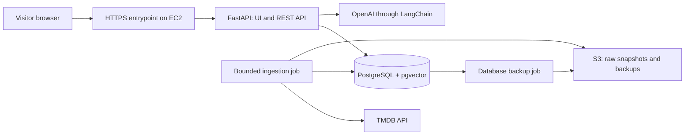

# Architecture

Status: core topology, user behavior, and implementation specification reviewed and published. Technical defaults still require their documented runtime checks, and paid deployment requires a concrete estimate and separate approval. Nothing here claims a verified implementation. Scope and constraints are maintained in `PROJECT.md`; acceptance criteria are in `SPEC.md`.

## Agreed topology

The application and database run under Docker Compose on one EC2 instance. PostgreSQL is reachable only inside the application network. The same application and database containers run locally. The browser uses FastAPI endpoints for recommendations and saved collections.

Collections belong to anonymous browser identities. Losing the identifier loses access to that collection; cross-device access and account recovery are outside the MVP. Use an unguessable identifier and enforce collection ownership at the API boundary; do not treat sequential database IDs as authorization.

## Ingestion and RAG design

1. Fetch TMDB discovery pages in descending vote-count order. Fetch required details, reject unusable records, and deduplicate by TMDB identity.
2. Save private raw snapshots to S3 and normalized metadata to PostgreSQL. Checkpoint completed work so retries and scheduled runs converge on 1,000 usable movies.
3. Build one searchable document per movie from its supported metadata. Embed only new or changed documents; keep the embedding model/version identifiable.
4. Extract included/excluded genres, maximum film length, release-year range, and allowed/excluded original languages from the English natural-language request into a validated schema. Translate allowed fields into parameterized SQL predicates, never execute model-generated SQL. Preserve mood and thematic preferences for semantic retrieval. Surface the interpreted constraints so mistakes can be corrected, and flag unsupported factual requirements.
5. Embed the request and retrieve candidate movies with pgvector, applying supported hard constraints deterministically. Select up to five movies and render factual fields from database records.
6. Use LangChain to pass retrieved context into explanation generation. Streaming is a requested priority: proposed transport is a streamed HTTP response carrying server-sent events, consumed with browser fetch so the request can use POST. Emit status and validated movie metadata before explanation deltas. Do not expose private reasoning. Define completion, error, disconnect cancellation, and partial-output behavior before implementation.
7. Accept only selected catalog movie identities in generated output. Streamed explanation text is incomplete until completion; metadata/ID validation is not proof that every generated claim is grounded. Grounding needs constrained prompts, output checks, and evaluation, with failed explanations discarded while catalog results remain available.
8. A save action links an existing catalog movie to the visitor's collection without duplicating the movie record.

The proposed implementation defaults, stream contract, and exact ranking are synthesized in `SPEC.md` for review. Similarity scores alone do not prove relevance; define insufficient-match behavior through examples and evaluation. Additional extraction work adds latency before retrieval; measure time to initial status, first movie metadata, first explanation token, and completion separately instead of treating a progress indicator as model TTFT.

## No-match relaxation

Agreed requirement: when the catalog has no matching movies, offer suggestions for broadening the request. This is an application component inside FastAPI, not another deployed service. The visitor accepted the bounded, single-change, explicit-selection behavior below.

Accepted behavior:

- If no movies satisfy the supported SQL filters, try a small bounded set of single-constraint changes, such as a longer runtime allowance or a wider year range. Query the catalog to retain only suggestions whose revised filters have candidates; offer at most three.
- Describe exactly what each suggestion changes. A candidate count means movies satisfying the revised filters, not a guarantee of semantic relevance.
- Keep the original request and constraints intact until the visitor explicitly selects a suggestion. Apply only the displayed change, then run retrieval again with the same mood/theme preferences. Preserve explicit genre/language exclusions and the catalog's adult-content exclusion.
- Contradictory constraints require clarification rather than silently selecting an interpretation. An irrelevant semantic result is not the same as zero SQL matches; handle it through the evaluation-backed insufficient-relevance policy, not arbitrary filter relaxation.
- If no bounded change helps, explain the limited catalog and invite an edited request. Generating suggestions does not require another LLM call.

Verification: no-match responses contain only catalog-backed suggestions; one selected suggestion changes only the stated constraint; excluded genres remain excluded; the no-suggestion case returns a useful empty state.

## Proposed technical defaults

Use `text-embedding-3-small` at 1,536 dimensions and the pinned `gpt-5.4-mini-2026-03-17` snapshot with reasoning disabled for extraction and explanations, pending evaluation and account access. Use LangChain's OpenAI integration with two explicit model calls rather than agent orchestration. Model selection and published-rate cost assumptions are in `research/models-and-api-budget.md`.

Start with exact cosine vector search for 1,000 movies; an approximate vector index, hybrid search, and a reranker require evidence of need. Keep SQL explicit and parameterized, with migrations, foreign keys, unique movie and collection-item constraints, and separate metadata for embedding configuration and ingestion checkpoints. A relational genre join demonstrates many-to-many modeling without hiding the query behind model-generated SQL.

## Optional observability

LangSmith tracing is requested as an optional enhancement. Proposed spans cover request interpretation, embeddings, SQL retrieval, and generation; structured application logs remain available independently. Configuration, trace content, credential handling, retention, and cost need checking before enabling external tracing. Tracing failures must not block recommendations.

## AWS operations still to specify

Proposed deployment envelope: Frankfurt, Linux x86 `t3.small`, Standard CPU credits, 20 GiB gp3, and small private S3 objects. Verify local memory use and exact regional prices before provisioning. Use a reverse proxy and short-lived direct-IP certificate; startup must verify/renew the certificate after time spent stopped. These mechanisms require deployment verification, not just configuration review.

Retain an Elastic IP through the agreed demonstration window so browser collection cookies continue to work after EC2 stop/start. This deliberately revises the earlier no-Elastic-IP research proposal: changing public IP changes the browser host and prevents the old cookie from being sent. Proposed retention is seven days, USD 0.84 at the documented IPv4 rate, including stopped intervals. A later release/reallocation can lose the browser's access to its collection; record that boundary in the shutdown and teardown instructions. See `research/deployment-verification.md` for sources and alternatives.

Restrict inbound access, configure secrets and least-privilege S3 access, bound request usage, and verify backup restoration before the deployment demonstration. Record structured stage timings and errors with log rotation; optional CloudWatch shipping and LangSmith tracing must not expand the paid baseline silently.

Document start, stop, and teardown separately: retained storage and other resources can remain billable while compute is stopped. Research and illustrative cost assumptions are in `research/aws-demo-hosting.md`. Paid provisioning requires explicit approval after a concrete deployment plan and cost estimate are available.

## Frontend display projection — 2026-11-10

The approved visual redesign retains the existing search and collection payloads.
A bounded read-only `/api/catalog-preview` exposes up to five randomly sampled
catalog records. Up to five previous IDs may be supplied as exclusions; unseen
records sort first, and small catalogs fill from previously shown records. The
response is not cacheable and reports whether more than five records exist. This
is browsing, not a popularity or semantic recommendation claim. `/api/movies/{id}/poster` looks up the catalog's
existing retained TMDB detail snapshot, validates the snapshot key/identity and
poster path, and redirects only to fixed HTTPS `image.tmdb.org` image sizes.
The application does not proxy image bytes or issue fresh TMDB/model requests.
Missing snapshot/image data falls back to the movie title in the browser.

This requires no database migration, ingestion, poster backfill or embedding
change. Existing Compose snapshot mounts serve the retained catalog; installations
without retained snapshots remain usable with title-led image fallback. The UI
uses shared safe-text movie rendering, inline selected-card details across
screen sizes, local fonts and the existing anonymous collection identity flow.
Additional result batches and contextual refinements require their own state,
ordering, retention and stream contracts before changing the search boundary.
